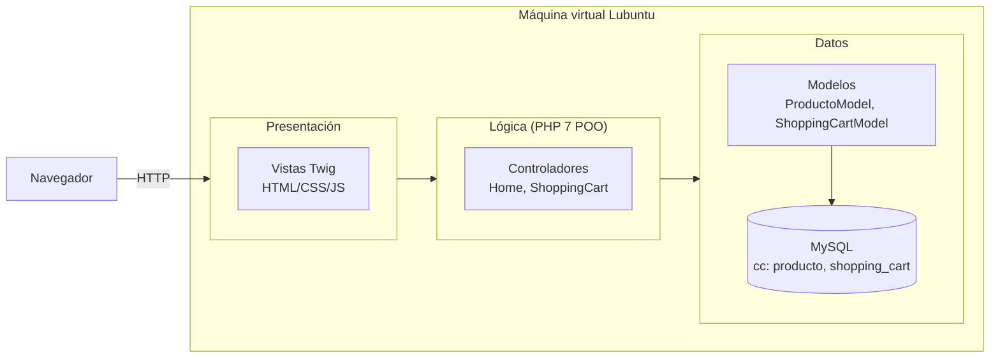
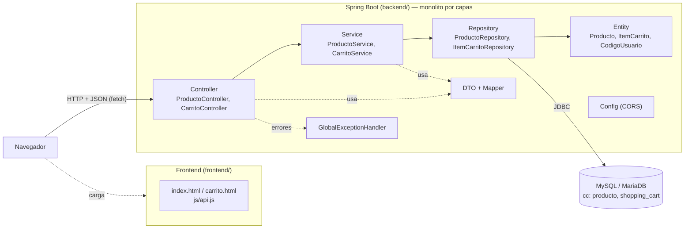
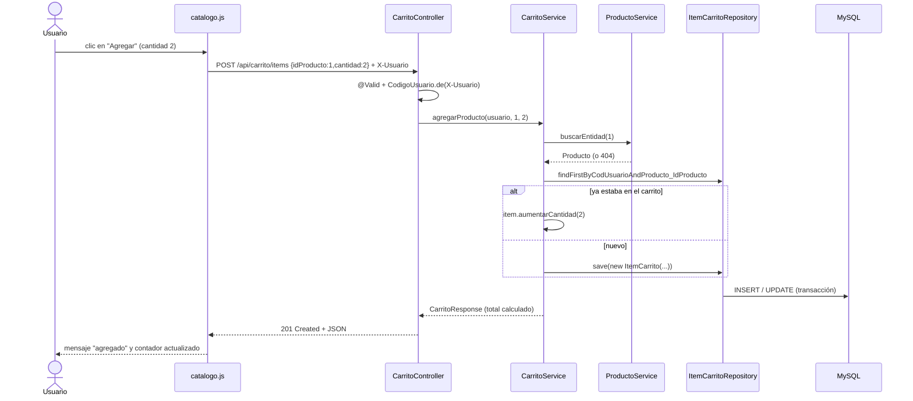

# 2. Arquitectura de la solución

## 2.1 Decisiones técnicas

| Decisión | Elección | Justificación |
|---|---|---|
| Lenguaje | Java 17+ (probado con JDK 21) | LTS; el `pom.xml` compila para 17, así funciona con JDK 17, 21 o 25 |
| Framework | **Spring Boot 3.5.16** | Rama 3.5 estable, compatible con Java 17–25 y con la documentación y tutoriales del curso. Spring Boot 4 cambia paquetes de pruebas y Jackson; para un proyecto académico se prefirió la rama más documentada |
| Spring Boot vs Quarkus | Spring Boot | El enunciado (CarritoGT.pdf) pide explícitamente Spring Boot con Controller/Service/Repository/Entity |
| Estilo | **Monolito por capas**, cliente‑servidor | RNF‑05: no se requieren microservicios |
| Persistencia | Spring Data JPA + Hibernate | Repositorios declarativos, consultas con parámetros |
| Base de datos | **MySQL/MariaDB** (perfil `mysql`, por defecto) | RNF‑08. Se usa el mismo esquema de 2 tablas del catedrático |
| BD de demostración/pruebas | H2 en memoria (perfil `h2`) | Permite ejecutar las pruebas automatizadas y una demo sin instalar MySQL |
| Validación | Bean Validation (`jakarta.validation`) | Reglas declarativas en los DTO |
| Frontend | HTML + CSS + **JavaScript puro** (`fetch`) | El enunciado prioriza el backend; sin `npm` ni compilación. Reemplaza Twig |
| Servir el frontend | El mismo Spring Boot publica `frontend/` como contenido estático | Un solo comando inicia todo; no requiere CORS. Opcionalmente puede servirse con Apache (CORS configurado) |
| Identificación del comprador | GUID en `localStorage` → encabezado `X-Usuario` | Equivale al GUID de sesión de PHP, pero sin estado en el servidor (REST) |
| Pruebas | JUnit 5, Mockito, MockMvc | Incluidas en `spring-boot-starter-test` |

## 2.2 Fase 1 — PHP orientado a objetos (3 capas)

PHP genera el HTML completo en el servidor: la vista y los datos viajan juntos.

## 2.3 Fase 2 — API REST con Spring Boot (n capas)

## 2.4 Responsabilidad de cada capa

| Capa | Paquete | Clases | Responsabilidad | No hace |
|---|---|---|---|---|
| Presentación | `frontend/` | `index.html`, `carrito.html`, `js/*.js`, `css/estilos.css` | Mostrar datos y enviar acciones a la API | Calcular totales ni acceder a la BD |
| Controller | `com.carritogt.controller` | `ProductoController`, `CarritoController` | Recibir HTTP, validar formato (`@Valid`), devolver JSON y códigos HTTP | Reglas de negocio ni SQL |
| DTO / Mapper | `com.carritogt.dto`, `com.carritogt.mapper` | `*Request`, `*Response`, `CarritoMapper` | Definir el contrato JSON; convertir entidades ↔ JSON | Persistir |
| Service | `com.carritogt.service` | `ProductoService`, `CarritoService` | Reglas del carrito, transacciones, seguridad por usuario | Conocer HTTP |
| Repository | `com.carritogt.repository` | `ProductoRepository`, `ItemCarritoRepository` | Consultas a la base de datos | Lógica de negocio |
| Entity (dominio) | `com.carritogt.entity` | `Producto`, `ItemCarrito`, `CodigoUsuario` | Representar las tablas y proteger sus invariantes | Conocer HTTP o JSON |
| Excepciones | `com.carritogt.exception` | `CarritoGtException` y subclases, `GlobalExceptionHandler` | Traducir errores a respuestas JSON coherentes | — |
| Configuración | `com.carritogt.config`, `application*.properties` | `WebConfig` | CORS, perfiles, conexión a la BD | — |

**Regla de dependencias:** cada capa solo llama a la de abajo (Controller → Service → Repository → Entity). Por eso el backend puede crecer, por ejemplo con otra tabla o un nuevo endpoint, sin reescribir el frontend, y el frontend puede cambiarse, por ejemplo a React, sin tocar el backend.

## 2.5 Programación orientada a objetos aplicada

| Principio | Dónde se ve |
|---|---|
| **Encapsulamiento** | `ItemCarrito` no tiene `setCantidad`: la cantidad solo cambia con `aumentarCantidad()` y `cambiarCantidad()`, que validan el rango 1–99. `Producto` es de solo lectura |
| **Abstracción** | `CarritoService` expone operaciones del negocio (`agregarProducto`, `vaciar`) y oculta JPA y SQL. Los repositorios son interfaces; Spring genera la implementación |
| **Herencia (justificada)** | `CarritoGtException` es abstracta; `RecursoNoEncontradoException`, `SolicitudInvalidaException` y `ReglaNegocioException` la extienden. Comparten la forma de construirse y de manejarse |
| **Polimorfismo** | `GlobalExceptionHandler.manejarPropias()` atiende cualquier `CarritoGtException` y llama a `getEstado()`; cada subclase responde con su propio código HTTP (404, 400 o 422) sin `if/instanceof` |
| **Objeto de valor** | `CodigoUsuario` (record) valida el formato del identificador una sola vez |
| **Bajo acoplamiento** | Inyección de dependencias por constructor; la API devuelve DTO, nunca entidades |
| **Alta cohesión** | Cada clase tiene una sola responsabilidad (ver tabla 2.4) |

## 2.6 Secuencia: agregar un producto

