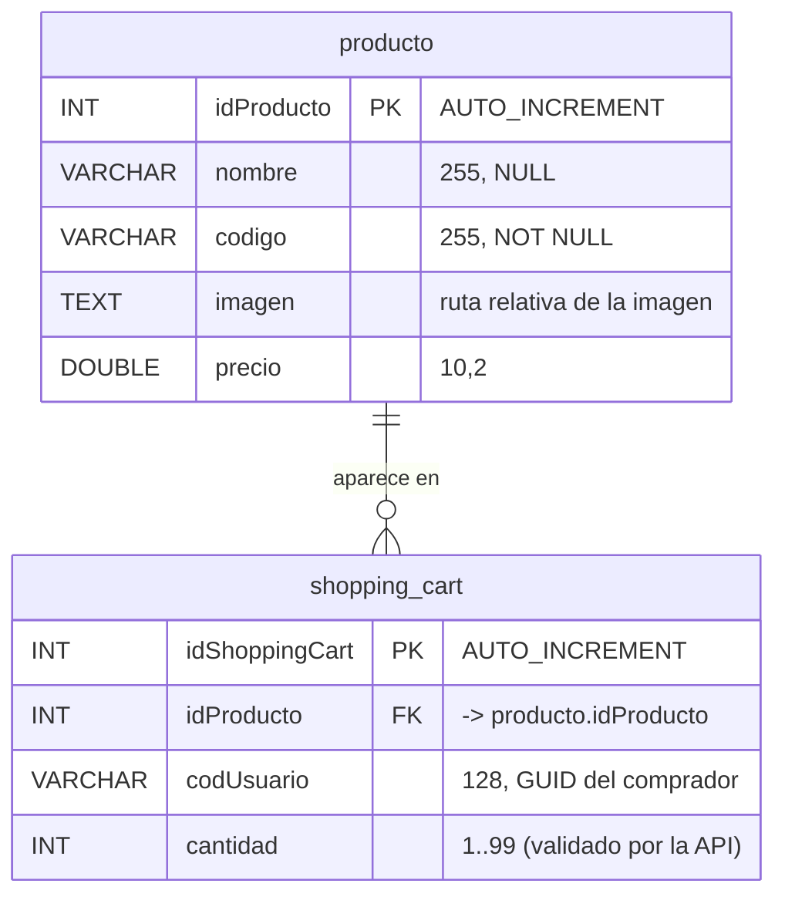

# 3. Base de datos y diccionario de datos

Se usa **el mismo modelo de dos tablas** del script provisto por el catedrático (`carrito-compra-basico/script/cc.sql`). No se agregaron tablas (RNF‑08, sección 14.1 del enunciado).

## 3.1 Modelo entidad‑relación

Un producto puede aparecer en 0 o muchos carritos; cada fila de `shopping_cart` pertenece a un solo producto (relación 1 : N).

## 3.2 Diccionario de datos

### Tabla `producto`

| Campo | Tipo | Nulo | Clave | Descripción | Entidad Java |
|---|---|---|---|---|---|
| `idProducto` | INT(11) AUTO_INCREMENT | No | PK | Identificador del producto | `Producto.idProducto` |
| `nombre` | VARCHAR(255) | Sí | — | Nombre comercial | `Producto.nombre` |
| `codigo` | VARCHAR(255) | No | — | Código o SKU | `Producto.codigo` |
| `imagen` | TEXT | Sí | — | URL relativa de la imagen (`images/product/...jpg`) | `Producto.imagen` |
| `precio` | DOUBLE(10,2) | Sí | — | Precio unitario | `Producto.precio` (`BigDecimal`) |

### Tabla `shopping_cart`

| Campo | Tipo | Nulo | Clave | Descripción | Entidad Java |
|---|---|---|---|---|---|
| `idShoppingCart` | INT(11) AUTO_INCREMENT | No | PK | Identificador del artículo del carrito | `ItemCarrito.idItem` |
| `idProducto` | INT(11) | Sí | FK `cc_profk_1` → `producto.idProducto` | Producto agregado | `ItemCarrito.producto` (`@ManyToOne`) |
| `codUsuario` | VARCHAR(128) | Sí | Índice no | GUID anónimo del comprador (encabezado `X-Usuario`) | `ItemCarrito.codUsuario` |
| `cantidad` | INT(11) | Sí | — | Unidades del producto (la API exige 1 a 99) | `ItemCarrito.cantidad` |

### Datos de prueba (4 productos)

| idProducto | nombre | codigo | imagen | precio |
|---|---|---|---|---|
| 1 | FinePix Pro2 3D Camera | 3DcAM01 | images/product/camera.jpg | 671.21 |
| 2 | EXP Portable Hard Drive | USB02 | images/product/external-hard-drive.jpg | 215.10 |
| 3 | Luxury Ultra thin Wrist Watch | wristWear03 | images/product/watch.jpg | 2121.86 |
| 4 | XP 1155 Intel Core Laptop | LPN45 | images/product/laptop.jpg | 10232.35 |

## 3.3 Scripts incluidos (`database/`)

| Archivo | Para qué sirve |
|---|---|
| `01_cc.sql` | Crea la base `cc`, las 2 tablas y los 4 productos. Es equivalente al script original, pero puede ejecutarse varias veces (`IF NOT EXISTS`) |
| `02_usuario_aplicacion.sql` | Crea el usuario `carritogt` con permisos solo sobre `cc` (la API no usa `root`) |
| `03_verificacion.sql` | Consultas para comprobar tablas, datos y la clave foránea |

También puede importarse el script **original** del catedrático (`script/cc.sql`). Si la base `cc` ya existe (por ejemplo, de la Fase 1), ese script falla en `CREATE DATABASE cc`: en ese caso basta con ejecutar `02_usuario_aplicacion.sql`.

## 3.4 Cómo se conecta Spring Boot

- `spring.jpa.hibernate.ddl-auto=none`: Hibernate **no** crea ni modifica tablas; usa las del script.
- `PhysicalNamingStrategyStandardImpl`: respeta los nombres exactos (`idProducto`, `codUsuario`). Sin esto, Spring los convertiría a `id_producto` y las consultas fallarían.
- Credenciales: variables de entorno `DB_URL`, `DB_USER`, `DB_PASSWORD` o el archivo `backend/config/application-local.properties`, que está excluido de Git.
- Precio: la columna es `DOUBLE(10,2)`; en Java se usa `BigDecimal` para que los cálculos de subtotal y total sean exactos.
