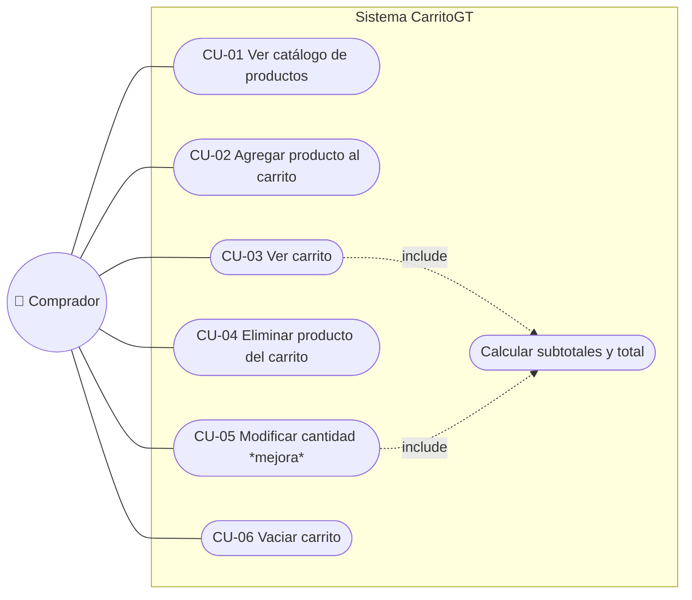

# 5. Requerimientos y casos de uso

## 5.1 Actor

| Actor | Descripción |
|---|---|
| **Comprador** (anónimo) | Persona que visita la tienda desde el navegador. No inicia sesión; se identifica con un GUID generado automáticamente |

## 5.2 Diagrama de casos de uso

Para dibujarlo en **DIA**, use la hoja *UML*: un *Actor* (Comprador), un *Caso de uso* (elipse) por cada CU‑0x, una *Asociación* entre el actor y cada caso, y una *Dependencia* con estereotipo `include` de CU‑03 y CU‑05 hacia "Calcular subtotales y total".

## 5.3 Trazabilidad requerimientos → implementación

| Código | Requerimiento | Caso de uso | Endpoint | Frontend | Prueba automatizada |
|---|---|---|---|---|---|
| RF‑01 | Listar productos | CU‑01 | `GET /api/productos` | `catalogo.js` | `listarProductosDevuelveLosCuatroDelScript` |
| RF‑02 | Información esencial del producto | CU‑01 | `GET /api/productos`, `/{id}` | tarjeta del catálogo | `obtenerProductoPorId` |
| RF‑03 | Agregar al carrito | CU‑02 | `POST /api/carrito/items` | botón "Agregar" | `flujoCompletoDelCarrito`, `agregarProductoNuevoGuardaUnArticulo` |
| RF‑04 | Ver carrito | CU‑03 | `GET /api/carrito` | `carrito.js` | `flujoCompletoDelCarrito`, `obtenerCarritoCalculaTotalYArticulos` |
| RF‑05 | Eliminar del carrito | CU‑04 | `DELETE /api/carrito/items/{id}` | botón "Eliminar" | `flujoCompletoDelCarrito`, `unUsuarioNoPuedeEliminarArticulosDeOtro` |
| RF‑06 | Consumir la API desde el frontend | todos | todos | `js/api.js` (`fetch`) | Prueba manual de extremo a extremo (ver 07_PRUEBAS) |
| RF‑07 | Presentar imágenes | CU‑01, CU‑03 | campo `imagen` | `crearImagen()` con imagen de respaldo | `listarProductosDevuelveLosCuatroDelScript` |
| RF‑08 | Manejar errores | todos | `ErrorResponse` | `mostrarMensaje()` | 9 pruebas de error (400/404/405/422) |
| Mejora | Modificar cantidad | CU‑05 | `PUT /api/carrito/items/{id}` | campo cantidad del carrito | `actualizarCantidadCambiaElArticulo` |
| Mejora | Total del carrito | CU‑03 | campo `total` | resumen del carrito | `obtenerCarritoCalculaTotalYArticulos` |
| — | Vaciar carrito (existía en PHP) | CU‑06 | `DELETE /api/carrito` | botón "Vaciar carrito" | `vaciarEliminaLosArticulosDelUsuario` |

## 5.4 Descripción breve de los casos de uso

**CU‑02 Agregar producto al carrito**
1. El comprador escribe la cantidad (1 a 99) y pulsa **Agregar**.
2. El sistema verifica que el producto exista y que la cantidad sea válida.
3. Si el producto ya estaba en su carrito, suma la cantidad; si no, crea el artículo.
4. El sistema confirma con un mensaje y actualiza el contador del carrito.
- *Alterno:* cantidad inválida o mayor de 99 en total → mensaje de error, el carrito no cambia.

**CU‑04 Eliminar producto del carrito**
1. El comprador pulsa **Eliminar** en una fila.
2. El sistema verifica que el artículo pertenezca a su carrito y lo elimina.
3. La tabla y el total se actualizan.
- *Alterno:* el artículo no existe o es de otro usuario → 404 y mensaje de error.
